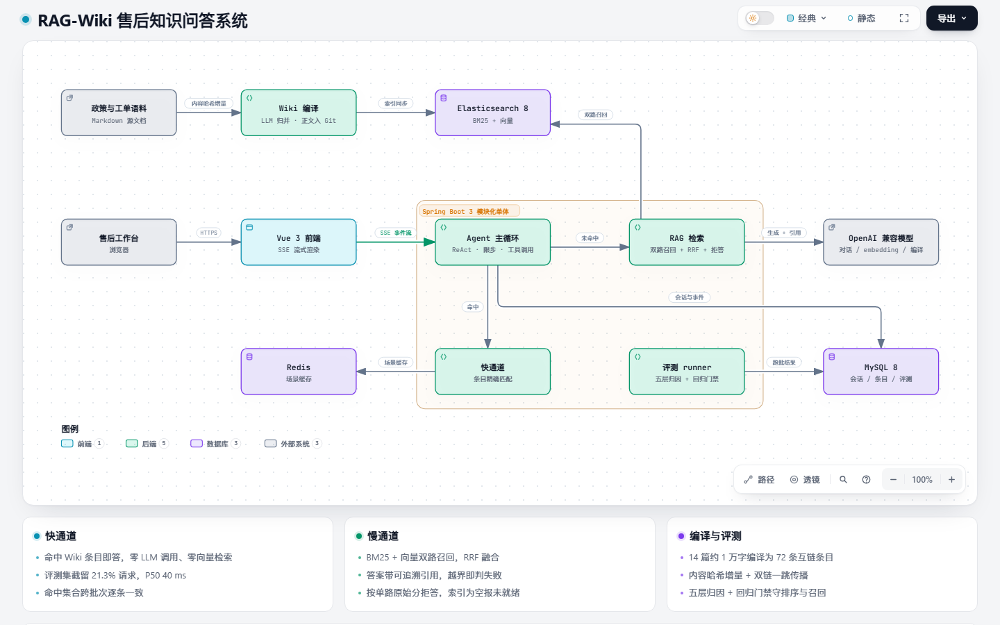
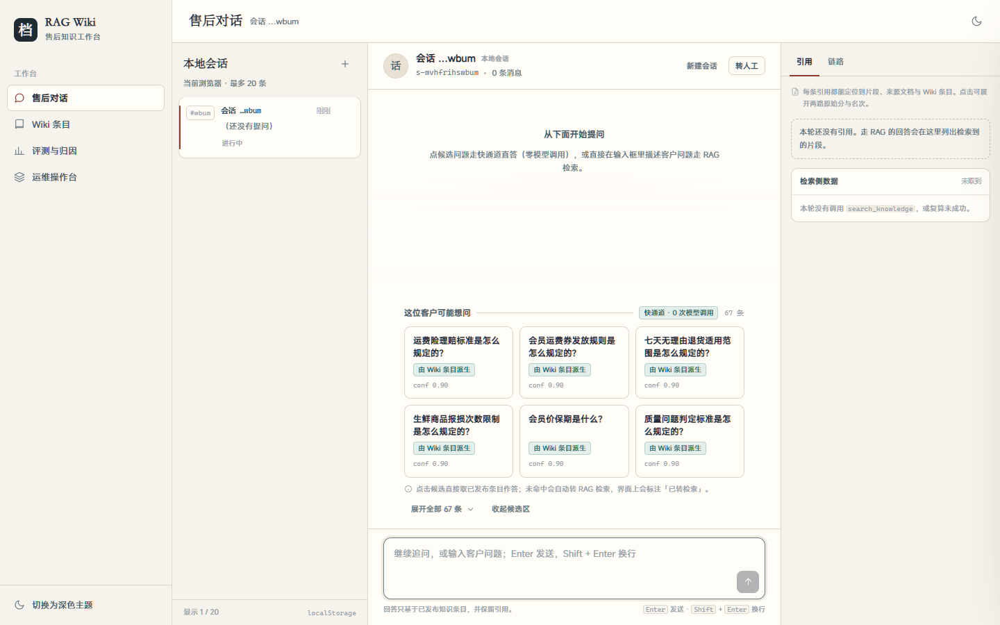
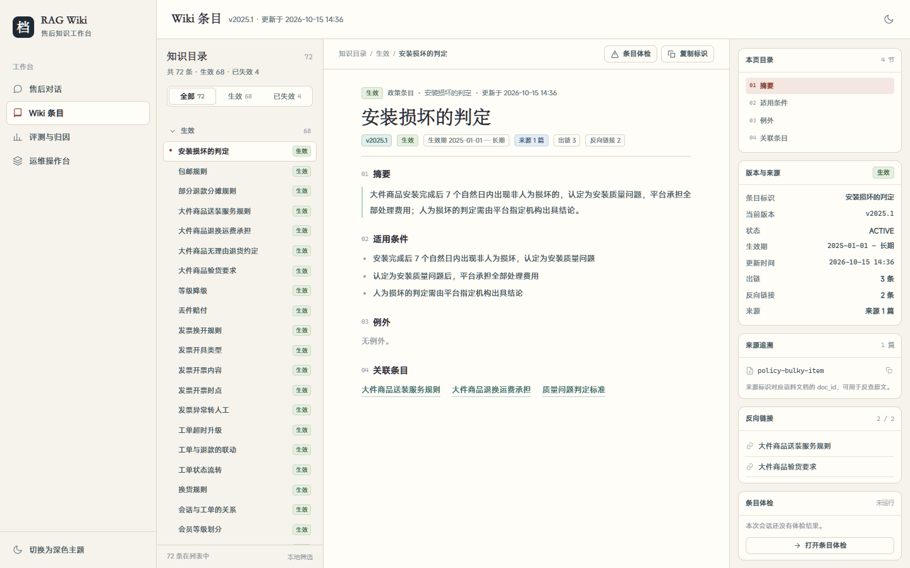
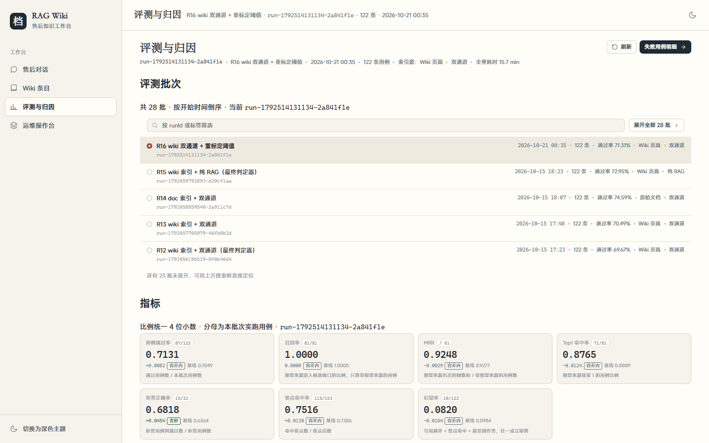
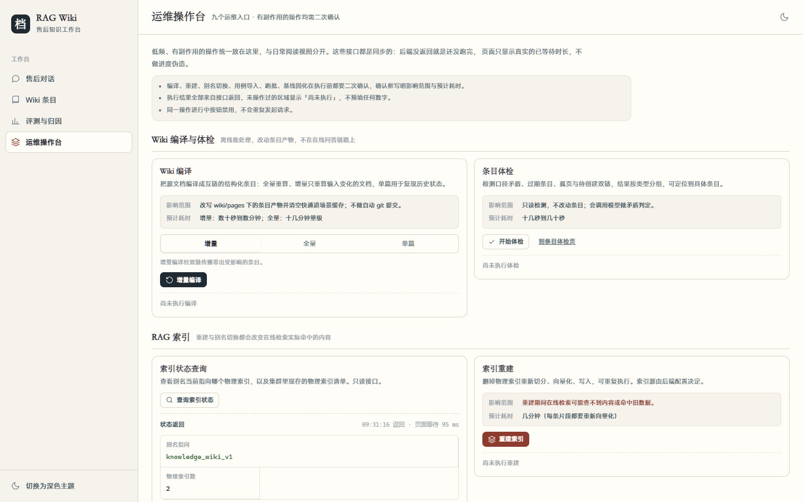

# RAG-Wiki

面向电商售后场景的智能问答系统。核心是 **LLM Wiki 快通道 + RAG 慢通道** 的双通道知识问答，
配套一套可复现的分层评测体系。

- **快通道**：政策文档编译成结构化互链条目，高频问题命中条目即答，**零 LLM 调用、零向量检索**
- **慢通道**：BM25 + 向量混合召回、RRF 融合、带引用生成，检索置信不足则拒答
- **评测**：失败用例按编译 / 召回 / 排序 / 生成 / 兜底五层归因，跨批次复现，接入回归门禁



> 可交互版本：[assets/diagrams/rag-wiki-architecture.html](assets/diagrams/rag-wiki-architecture.html)（单文件，支持缩放、路径追踪、明暗主题）。

## 实测结果

同一份 122 条用例、同一模型、同一判定器，只改一个变量跑出的四批数据：

| 指标 | wiki + 双通道 | doc + 双通道 | wiki + 纯 RAG | wiki + 双通道（阈值重标定） |
| --- | --- | --- | --- | --- |
| 通过数 / 总数 | 86/122 | 91/122 | 89/122 | 87/122 |
| 召回率 | 1.0000 | 1.0000 | 1.0000 | 1.0000 |
| MRR | 0.9277 | 0.9051 | **0.9339** | 0.9248 |
| Top1 命中率 | 0.8889 | 0.8395 | **0.9012** | 0.8765 |
| 拒答正确率 | 0.6364 | 0.6818 | 0.6818 | **0.6818** |
| 幻觉率 | 0.0984 | **0.0738** | 0.1230 | **0.0820** |
| 慢通道输入 token | 206,790 | 206,974 | 276,232 | 212,147 |
| 慢通道 P50 | 8882 ms | 6282 ms | 6430 ms | 7456 ms |
| 快通道 P50 | **40 ms** | 39 ms | — | 43 ms |
| 快通道命中率 | 21.31% | 21.31% | 0 | 21.31% |

几条能站住的结论，其余数字的解读见下文：

- **快通道的成本优势是真实的**：21.3% 的请求被截在模型之前，这 26 轮零 token；慢通道输入 token 降 25.1%、
  输出降 15.7%；快通道 P50 比慢通道低两个数量级。
- **Wiki 索引改善的是排序，不是召回**：两套索引源召回率都是 1.0，差异全部落在 MRR / Top1 上；
  8 批重复运行中 wiki 组最差（0.9277）仍优于 doc 组最好（0.9051）。版本冲突类对抗样本 Top1 为 96% vs 83%。
- **通过率不能作为结论依据**：同配置重跑就有 5.7% 的用例翻转（根因是 embedding 服务返回的向量不保证逐位可复现），
  所以上表通过率只作参考，结论只建立在跨批次方向稳定的指标上。

## 技术栈

Java 21 · Spring Boot 3 · MyBatis-Plus · MySQL 8.4 · Redis 7.4 · Elasticsearch 8.15（BM25 + 向量 + RRF）
· OpenAI 兼容接口 · Markdown + Git · Vue 3 + Vite + TypeScript

## 界面

| 售后对话（快通道候选 + 慢通道检索） | Wiki 条目（四段式 + 双链） |
| --- | --- |
|  |  |

| 评测与归因 | 运维操作台 |
| --- | --- |
|  |  |

## 双通道怎么工作

```text
POST /api/chat
      │
      ├─ 快通道：规范化精确匹配 / 条目关键词全命中 → 直接作答（无 THINKING、无 TOOL_CALL、无模型调用）
      │
      └─ 慢通道：Agent 主循环 → search_knowledge 工具 → BM25 + 向量双路召回 → RRF 融合
                                              → 原始分低于阈值则拒答 → 否则带引用生成
```

两条通道互斥，不会既直答又检索。命中判定分两级：规范化后完全相同的精确匹配，以及**条目关键词全部出现在问题里**
的关键词匹配；后者还要求关键词有区分度（至少两个，或有一个长度 ≥ 3），否则一个「运费」就会把
「退货运费谁承担」匹配到「运费计价重量」上去。

编译 → 派生 → 发布是一条链：`/wiki/compile` 更新条目标题与来源，`/fastpath/entries/derive` 按条目重新派生候选，
`/fastpath/entries/publish` 才让候选生效、并把来源已失效的条目下线。候选条目的**答案正文在派生时固化**，
所以政策改版后只编译不派生，快通道仍会答旧内容。

## 快速开始

后端位于 `backend/`，以下命令均在该目录执行：

```bash
cd backend
cp .env.example .env          # .env 不入库；默认值已与 docker-compose.yml 对齐
bash scripts/dev.sh up        # Windows: powershell -ExecutionPolicy Bypass -File scripts/dev.ps1 up
```

`up` 会等到 MySQL / Redis / ES 三个容器全部 `healthy` 才返回。其余命令：`status` / `health` / `logs` / `down` / `restart` / `reset`。

初始化数据库与语料：

```bash
docker exec -i -e MYSQL_PWD=rag_wiki rag-wiki-mysql mysql -u rag_wiki rag_wiki < sql/schema.sql
docker exec -i -e MYSQL_PWD=rag_wiki rag-wiki-mysql mysql -u rag_wiki rag_wiki < sql/seed.sql
python scripts/check-corpus.py
```

启动应用：

```bash
set -a && . ./.env && set +a
mvn spring-boot:run -Dspring-boot.run.arguments="--spring.config.additional-location=optional:file:./config/ --spring.profiles.active=local"
```

验证：`curl http://localhost:8080/actuator/health`，Swagger UI 在 http://localhost:8080/swagger-ui/index.html 。

启动前端：

```bash
cd frontend
pnpm install
pnpm dev          # http://127.0.0.1:5173
```

开发期 `/api` 与 `/actuator` 由 Vite 代理到 `VITE_API_BASE_URL`（默认 `http://localhost:8080`），前端只请求同源相对路径。
质量门与设计约定见 [frontend/README.md](frontend/README.md)。

## 核心接口

完整定义见 Swagger UI，错误码与 SSE 事件约定见 `docs/接口文档.md`（本地文档，不入库）。

```bash
# 对话（SSE）：Agent 先试快通道，未命中走慢通道
curl -N -X POST http://localhost:8080/api/chat -H 'Content-Type: application/json' \
  -H 'Accept: text/event-stream' \
  -d '{"sessionId":"demo-1","message":"帮我查一下订单 SO20250901001 现在到哪了"}'

# 检索：返回两路原始分与名次 + RRF 融合分
curl -X POST http://localhost:8080/api/rag/search -H 'Content-Type: application/json' \
  -d '{"question":"退货运费谁出"}'

# 快通道：场景候选 / 作答 / 派生 / 发布 / 流量沉淀
curl 'http://localhost:8080/api/fastpath/entries?scene=aftersale'
curl -X POST http://localhost:8080/api/fastpath/answer -H 'Content-Type: application/json' -d '{"question":"退款发票冲红"}'

# Wiki：全量 / 增量 / 单篇编译，条目体检
curl -X POST http://localhost:8080/api/wiki/compile -H 'Content-Type: application/json' -d '{"incremental":true}'
curl -X POST http://localhost:8080/api/wiki/lint

# 索引重建（离线批处理，可重复执行）
curl -X POST http://localhost:8080/api/rag/index/rebuild

# 评测：跑批 / 报告 / 固化基线 / 门禁
curl -X POST http://localhost:8080/api/eval/run -H 'Content-Type: application/json' -d '{"label":"wiki 双通道","caseTypes":[]}'
curl http://localhost:8080/api/eval/gate/<runId>
```

SSE 事件名为 `STARTED` / `THINKING` / `TEXT_DELTA` / `TOOL_CALL` / `TOOL_RESULT` / `FINISHED` / `ERROR`，
`FINISHED` 是唯一终止事件，`reason` 取 `COMPLETED` / `MAX_STEPS` / `CANCELLED` / `FAILED`。
流一旦开始推送 HTTP 状态就已经是 200，模型报错只能在流里用 `ERROR` 事件传达。

### 没有模型密钥时怎么验

`model.chat` 三件套留空时应用照常启动，一提问返回 `ERROR code=1001` 并提示缺哪几项配置。
要完整跑通链路，可以起一个 OpenAI 兼容的桩上游替代**模型输出**：

```bash
javac -d target/stub src/test/java/com/ragwiki/support/StubModelServer.java
java -cp target/stub com.ragwiki.support.StubModelServer 8090 20
CHAT_BASE_URL=http://127.0.0.1:8090/v1 CHAT_API_KEY=stub CHAT_MODEL=stub-model \
  java -jar target/rag-wiki-0.0.1-SNAPSHOT.jar --spring.config.additional-location=optional:file:./config/ --spring.profiles.active=local
```

桩只替换模型输出；流式协议解析、SSE 推送、工具调用、落库、恢复都由本项目代码真实执行。

## 索引与检索

索引源由 `rag.index.source` 决定：`doc` 读 `corpus/policies`，`wiki` 读 `wiki/pages`。
两者写不同的物理索引（`knowledge_doc_v1` / `knowledge_wiki_v1`），查询一律走别名 `knowledge_chunks`。
**切换索引源只需要改别名指向**，不用改代码也不用重启：

```bash
curl -X POST http://localhost:19200/_aliases -H 'Content-Type: application/json' -d '{"actions":[
  {"remove":{"index":"knowledge_wiki_v1","alias":"knowledge_chunks"}},
  {"add":{"index":"knowledge_doc_v1","alias":"knowledge_chunks","is_write_index":true}}]}'
```

拒答判定用的是**单路原始分**，不是融合分——融合分只反映名次，没有绝对量纲。
两个阈值在 `config/application.yml` 的 `rag.refuse.*`（当前 8.5 / 0.715），是在 122 条用例的实测分数分布上
扫出来的净最优解。**换 embedding 模型、扩语料、改切分策略都要重新标定**。

两路都召回为空时接口按 `RAG_INDEX_EMPTY`（4001）报错，而不是判拒答——索引没建好是运维问题，
不能伪装成「超出服务范围」。

## 目录结构

```text
.
├── assets/                     架构图与界面截图（README 引用）
├── backend/                    后端入口（Spring Boot 与运行依赖）
│   ├── src/main/java/com/ragwiki/
│   │   ├── common/             公共层：统一返回体、错误码、模型客户端、Markdown 解析
│   │   ├── config/             装配层：数据源、MyBatis-Plus、ES、OpenAPI
│   │   ├── agent/              Agent 内核：协议、主循环、工具、会话与事件存储
│   │   ├── wiki/               LLM Wiki：编译、双链、增量、失效检测、lint、快通道
│   │   ├── rag/                RAG：切分、索引同步、双路召回、RRF、拒答
│   │   └── eval/               评测：用例、runner、指标、分层归因、回归门禁
│   ├── config/                 Spring Boot 配置模板与个人覆盖示例
│   ├── corpus/                 语料：政策文档（Markdown + frontmatter）与历史工单（JSONL）
│   ├── wiki/pages/             Wiki 编译产物，一个条目一个 Markdown 文件
│   ├── eval/                   评测用例、回归基线、各批次报告
│   ├── sql/                    建表与演示数据
│   ├── scripts/                中间件管理（dev.sh / dev.ps1）与语料校验
│   └── docker-compose.yml      本地中间件编排
├── frontend/                   前端入口（Vue 3 + Vite + TypeScript + Pinia）
│   ├── src/                    api / components / features / layouts / pages / router / sse / stores / styles
│   ├── tests/e2e/              Playwright 端到端用例
│   └── scripts/                截图、断点与主题持久化校验脚本
├── docs/                       设计文档（本地，不入库）
├── README.md
└── AGENTS.md                   协作约定（本地，不入库）
```

后端采用「模块优先、模块内分层」的单体结构：`agent / wiki / rag / eval` 只依赖 `common`，
`config` 只做装配；业务模块之间不互相引用内部类，需要协作走对方 `api` 包暴露的接口。

`corpus/README.md` 里登记了几个**刻意埋设**的验证点（版本冲突、跨文档重叠、孤页候选），不要当作脏数据清理。

## 配置分层

取值优先级：**环境变量 > `config/application-local.yml` > `config/application.yml` 默认值**。

```text
.env                                  本地变量与密钥，gitignore
config/application.yml                统一模板，只写 ${VAR:default}，入库
config/application-local.yml          个人覆盖，gitignore
config/application-local.yml.example  覆盖示例，入库
```

`.env` 只放跟本机环境绑定的值（中间件连接、端口、模型凭据）；检索参数、切分参数、拒答阈值、Agent 步数
只写在 `config/application.yml` 一处。调优参数如果在两处各写一份默认值，必然漂移。

模型接入拆成三组独立配置，可分别换模型、分别限额、分别排查：

| 配置组 | 用途 | 环境变量前缀 |
| --- | --- | --- |
| `model.chat` | 在线问答主链路 | `CHAT_` |
| `model.embedding` | RAG 向量化，索引与查询必须同模型 | `EMBEDDING_` |
| `model.compile` | Wiki 离线编译 | `COMPILE_` |

`EMBEDDING_DIMENSIONS` 必须与 ES 索引 `dense_vector` 的 `dims` 一致，应用启动时校验，不一致直接启动失败。

## 本地服务

| 服务 | 地址 |
| --- | --- |
| MySQL | `localhost:13306`，库 `rag_wiki` |
| Redis | `localhost:16379` |
| Elasticsearch | http://localhost:19200 |
| 应用 | `localhost:8080` |
| 前端 | http://127.0.0.1:5173 |

端口与账号全部可用 `.env` 覆盖，默认值仅用于本地开发。

## 测试

```bash
cd backend && mvn test     # 需要中间件已启动
cd frontend && pnpm typecheck && pnpm lint && pnpm test:e2e
```

- 后端 232 个用例，全部通过；行覆盖率 84.1%，分支覆盖率 73.1%，`mvn test` 同时执行行覆盖率门禁（0.80）
- 集成测试跑真实 MySQL 与真实 HTTP，不是内存替身；模型统一用 `StubModelServer` 桩替身，不需要真实密钥
- 集成测试只写带随机后缀的临时行并在用例结束后删掉，不会清空本机已有数据
- 前端 `typecheck` 必须带 `-p tsconfig.app.json`，根 `tsconfig.json` 是 project references 形式，直接跑会检查一个空配置

## 环境说明

- ES 关闭安全认证且为单节点，**仅供本地开发，禁止照搬上线**
- ES 官方镜像不含中文分词插件，检索用内置 `cjk`（bigram）分析器
- 数据库连接不在启动时校验：HikariCP 首次取连接才建池，库不可用时应用仍会启动，状态由 `/actuator/health` 暴露
- 应用不做自动 git 提交：Wiki 编译产物该由人看过 diff 之后再提交，后台改仓库状态是意外副作用

## 阶段进度

| 阶段 | 内容 | 状态 |
| --- | --- | --- |
| 0 | 仓库与环境：中间件编排、配置规范、语料 | 已完成 |
| 1 | Spring Boot 骨架 | 已完成 |
| 2 | Agent 最小闭环（主循环 / SSE / 工具调用） | 已完成 |
| 3 | RAG 基础闭环（混合召回 / RRF / 引用 / 拒答） | 已完成 |
| 4 | LLM Wiki 编译（归并 / 双链 / 增量 / 失效 / lint） | 已完成 |
| 5 | 快通道与快慢分流 | 已完成 |
| 6 | 评测体系（分层归因 / 对比实验 / 回归门禁） | 已完成 |
| 7 | 收尾与面试表达 | 进行中 |
| 8 | 演示界面与设计沉淀 | 进行中 |
